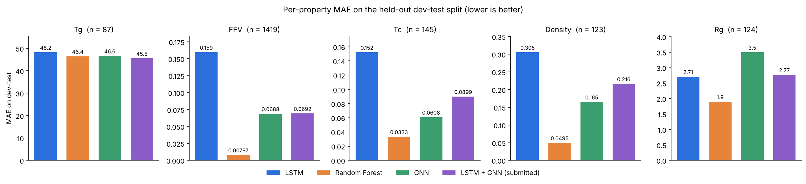
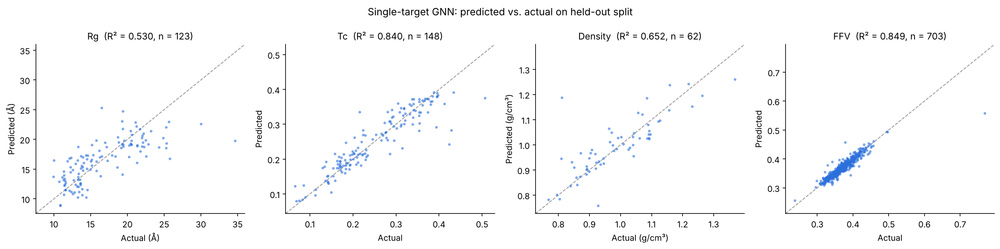

# Polymer Prediction

Machine-learning models that predict five polymer properties from a SMILES string, built for the
[NeurIPS 2025 Open Polymer Prediction challenge](https://www.kaggle.com/competitions/neurips-open-polymer-prediction-2025).

| Property  | Description                     | Units          | Range in `train.csv` | Labelled rows |
|-----------|---------------------------------|----------------|----------------------|--------------:|
| `Tg`      | Glass transition temperature    | °C             | −148 to 472          | 511   |
| `FFV`     | Fractional free volume          | dimensionless  | 0.23 to 0.78         | 7,030 |
| `Tc`      | Thermal conductivity            | W/(m·K)        | 0.05 to 0.52         | 737   |
| `Density` | Density                         | g/cm³          | 0.75 to 1.84         | 613   |
| `Rg`      | Radius of gyration              | Å              | 9.7 to 34.7          | 614   |

`train.csv` has 7,973 polymers, but labels are sparse: most rows carry only one or two of the five properties.

---

## Results

All numbers below come from running the notebooks in this repo on the competition `train.csv`.

### Multi-task models (`Prediction final.ipynb`)

Scored on the held-out dev-test split (20% of `train.csv`, 1,595 polymers). Lower is better everywhere.
wMAE is the competition-style weighted MAE (see [Metrics](#prediction-finalipynb-multi-task-models-and-submission)).

| Model | wMAE | MAE Tg (°C) | MAE FFV | MAE Tc (W/(m·K)) | MAE Density (g/cm³) | MAE Rg (Å) | Overall MSE |
|---|---:|---:|---:|---:|---:|---:|---:|
| LSTM                     | 0.195 | 48.2 | 0.159  | 0.152  | 0.305  | 2.71 | 174.9 |
| **Random Forest**        | **0.063** | 46.4 | **0.0080** | **0.033** | **0.049** | **1.90** | 163.7 |
| GNN                      | 0.121 | 46.6 | 0.069  | 0.061  | 0.165  | 3.50 | 158.3 |
| LSTM + GNN (submitted)   | 0.138 | **45.5** | 0.069  | 0.090  | 0.216  | 2.77 | **153.5** |

Labelled values in dev-test: Tg 87, FFV 1,419, Tc 145, Density 123, Rg 124.



What the results show:
- **The Random Forest on Morgan fingerprints is the best model** on four of the five properties and on wMAE, by a wide
  margin (about half the GNN's error and a third of the LSTM's).
- **The submitted ensemble is not the best option.** Averaging LSTM and GNN wins only on `Tg` and on overall MSE (which
  is mostly `Tg`). On wMAE it is worse than the GNN alone, and more than twice the Random Forest's error.
  Submitting the Random Forest, or adding it to the ensemble, would likely score better.
- `Tg` is hard for every model (MAE around 46 °C), with only 511 labelled training examples.
- The Random Forest is deterministic, and its overall MSE (163.74) matches the 163.83 from the original Kaggle run.
  The neural models depend on the search budget: this run used `N_TRIALS=3 EPOCHS=50` on CPU, while the Kaggle run used
  10 trials × 200 epochs on a GPU and reported overall MSE of 240.5 (LSTM) and 169.5 (GNN).

Chosen hyperparameters: LSTM `output_dim=17, LSTMunits=93, lr=7.5e-3`; GNN `num_layer=5, hidden_size=157, lr=7.4e-3`.
Predictions for `test.csv` are in [`results/submission.csv`](results/submission.csv).

### Single-target GNNs (`GNN_Polymer_Prediction_All.ipynb`)

Scored on each target's held-out split (1000 epochs, best checkpoint by held-out MSE).
"Predict mean" is the MSE of always predicting the training mean, as a floor to beat.

| Target  | Train / test | MSE | MAE | R² | Predict-mean MSE |
|---------|-------------:|----:|----:|---:|-----------------:|
| Rg (Å)        | 491 / 123  | 10.34    | 2.40    | **0.53** | 22.14   |
| Tc (W/(m·K))  | 589 / 148  | 0.00137  | 0.0247  | **0.84** | 0.00855 |
| Density (g/cm³) | 551 / 62 | 0.00529  | 0.0473  | **0.65** | 0.0152  |
| FFV           | 6327 / 703 | 0.000158 | 0.00685 | **0.85** | 0.00104 |



Notes:
- The best epoch is picked on the same held-out split it is scored on, so these numbers are slightly optimistic.
  `results/gnn_single_target_metrics.csv` also lists the final-epoch scores (no selection): R² 0.53 / 0.82 / 0.39 / 0.80.
  Density is the most affected: its best epoch was 20 out of 1000 on only 62 test molecules, and it overfits after that.
- For comparison, the legacy per-target notebooks ended at "Test MSE" 22.2 (Rg) and 0.0085 (Tc), which is the
  predict-the-mean MSE. Those models had collapsed to predicting the mean because of the shape bug described below.

---

## Repository structure

```
.
├── Prediction final.ipynb               # Main pipeline: LSTM, Random Forest, GNN (multi-task) + submission
├── GNN_Polymer_Prediction_All.ipynb     # Single-target GNNs for Rg, Tc, Density, FFV (PyTorch Geometric)
├── GNN_Polymer_Prediction_{Rg,Tc,Density,FFV}.ipynb   # Legacy per-target notebooks (superseded, see below)
├── results/
│   ├── dev_test_metrics.csv             # Per-model, per-property metrics from Prediction final.ipynb
│   ├── dev_test_mae_by_property.png
│   ├── gnn_single_target_metrics.csv    # Metrics from GNN_Polymer_Prediction_All.ipynb
│   ├── gnn_parity.png
│   └── submission.csv                   # LSTM + GNN ensemble predictions for test.csv
├── models/                              # Best checkpoint of each single-target GNN (.pth)
├── requirements.txt
└── data/                                # Not committed: put the Kaggle CSVs here
```

The notebooks are committed **with their outputs**, so you can read the results without running anything.

---

## Getting started

### 1. Install

Python 3.10+ is required. The notebooks were last run on Python 3.13, CPU only, with the versions in `requirements.txt`.

```bash
pip install -r requirements.txt
```

### 2. Get the data

Download the competition files from the [Kaggle data page](https://www.kaggle.com/competitions/neurips-open-polymer-prediction-2025/data)
(you need to accept the competition rules first) and put them in `data/`:

```
data/
├── train.csv
├── test.csv
└── sample_submission.csv
```

With the Kaggle CLI:

```bash
kaggle competitions download -c neurips-open-polymer-prediction-2025 -p data
```

```bash
cd data && unzip neurips-open-polymer-prediction-2025.zip train.csv test.csv sample_submission.csv && cd ..
```

The results below were produced with the original competition release of `train.csv` (7,973 rows).

### 3. Run

From the repository root, either open the notebooks in Jupyter, or run them headless (outputs are written back into the notebook):

```bash
OMP_NUM_THREADS=1 jupyter nbconvert --to notebook --execute --inplace GNN_Polymer_Prediction_All.ipynb
```

```bash
OMP_NUM_THREADS=2 N_TRIALS=3 EPOCHS=50 jupyter nbconvert --to notebook --execute --inplace "Prediction final.ipynb"
```

Both notebooks still run in their original environments too: `Prediction final.ipynb` reads the data from
`/kaggle/input/...` on Kaggle, and `GNN_Polymer_Prediction_All.ipynb` installs its dependencies and mounts Google Drive on Colab.

**Configuration (environment variables)**

| Variable | Default | Used by | Meaning |
|---|---|---|---|
| `N_TRIALS` | `10` | Prediction final | Optuna trials per model (LSTM and GNN) |
| `EPOCHS` | `200` | Prediction final | Max epochs per trial (stops early after 50 epochs without improvement) |
| `GNN_EPOCHS` | `1000` | GNN_All | Epochs per target |
| `POLYMER_DATA_DIR` | `data` | Prediction final | Folder with the CSVs |
| `POLYMER_RESULTS_DIR` | `results` | Prediction final | Where metrics, plots and the submission are written |
| `POLYMER_PROJECT_DIR` | `.` | GNN_All | Folder containing `data/`; `models/` and `results/` are written here |
| `OMP_NUM_THREADS` | all cores | both | On CPU, 1–2 threads is much faster for these small models than letting PyTorch use every core |

**Runtime on a 4-core CPU:** `GNN_Polymer_Prediction_All.ipynb` takes about 25 min. `Prediction final.ipynb` with
`N_TRIALS=3 EPOCHS=50` takes about 1.5 hours. The default budget (10 trials × 200 epochs) is meant for a GPU.

---

## How the notebooks work

### `Prediction final.ipynb`: multi-task models and submission

1. **Split:** 60% train / 20% validation / 20% dev-test (`random_state=42`).
2. **LSTM** (`LSTMMolecularPredictor` from [`torch_molecule`](https://github.com/liugangcode/torch-molecule)): reads the
   SMILES as a character sequence and predicts all 5 properties at once, masking missing labels in the loss.
   Optuna searches the embedding size, LSTM units and learning rate.
3. **Random Forest baseline:** 1024-bit Morgan fingerprints (radius 2), one `RandomForestRegressor` per property,
   trained on train + validation.
4. **GNN** (`GNNMolecularPredictor` from `torch_molecule`): a multi-task graph network. Optuna searches the number of
   layers, hidden size and learning rate.
5. **Ensemble:** the LSTM and GNN predictions are averaged, scored on dev-test and written to `results/submission.csv`.

**Metrics:** MSE and MAE per property, plus a **weighted MAE (wMAE)** modelled on the competition metric. Each property's
MAE is divided by that property's range and weighted by `sqrt(1/n_labels)`, so the four sparse properties count as much as FFV.
The "Overall MSE" pools every labelled value, so `Tg` (values in the hundreds) dominates it.

### `GNN_Polymer_Prediction_All.ipynb`: single-target GNNs

One graph network per property (`Rg`, `Tc`, `Density`, `FFV`), built directly in PyTorch Geometric:

```
Node features (5): atomic number, degree, formal charge, hybridization, aromatic
GCNConv(5 → 64) → ReLU → GCNConv(64 → 64) → ReLU → global mean pool → Linear(64 → 64) → ReLU → Linear(64 → 1)
```

| Target  | Train / held-out split | Epochs | Optimizer |
|---------|------------------------|--------|-----------|
| Rg      | 80 / 20 | 1000 | Adam (lr = 0.001) |
| Tc      | 80 / 20 | 1000 | Adam (lr = 0.001) |
| Density | 90 / 10 | 1000 | Adam (lr = 0.001) |
| FFV     | 90 / 10 | 1000 | Adam (lr = 0.001) |

The checkpoint with the lowest held-out MSE is saved to `models/gnn_best_<target>_model.pth`.

### Legacy per-target notebooks

`GNN_Polymer_Prediction_{Rg,Tc,Density,FFV}.ipynb` are the earlier one-notebook-per-target versions of the notebook above,
kept for history. They have the shape bug described below, so the "Test MSE" values saved in them are not real MSEs.

---

## Fixes made to get correct, runnable results

- **Shape bug in the single-target GNN.** The model returned predictions of shape `[batch, 1]` while the targets had
  shape `[batch]`. `MSELoss` silently broadcast that to a `[batch, batch]` matrix (the legacy notebooks' output shows
  PyTorch's warning about it), which pulls every prediction toward the batch mean and makes the printed "Test MSE"
  meaningless. The model now returns `[batch]`.
- **Paths work locally as well as on Kaggle and Colab.** Hard-coded `/kaggle/input/...` and Google Drive paths now fall
  back to `./data`, and the Colab-only steps (`pip install`, `drive.mount`) only run on Colab.
- **Updated for `torch_molecule` 0.2.x,** where `verbose` is a string and passing `True` silently turns logging off.
- **Updated for current RDKit:** `AllChem.GetMorganFingerprintAsBitVect` was replaced with `rdFingerprintGenerator`, which
  produces the same bits.
- **More evaluation, saved outputs:** an ensemble score, wMAE, R², a predict-the-mean baseline, summary tables, plots,
  and CSVs in `results/`.
- Removed about 25 MB of stale progress-bar widget data from `Prediction final.ipynb`.
